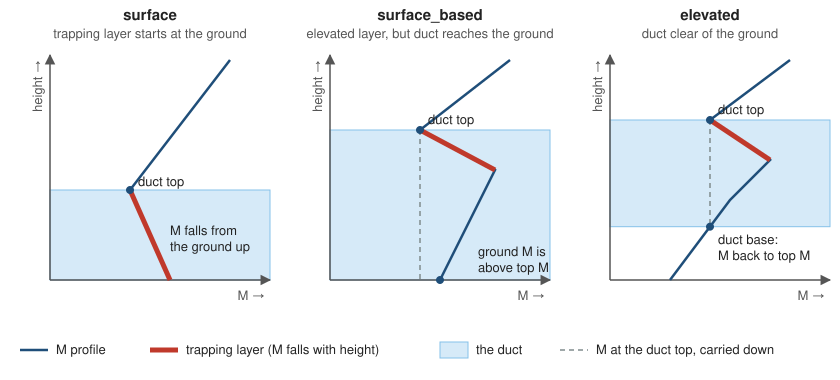
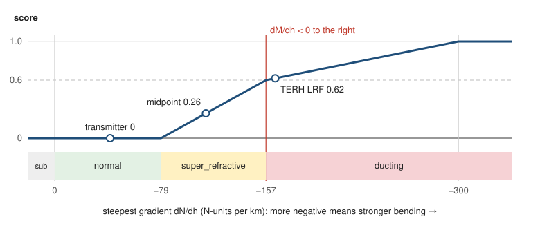
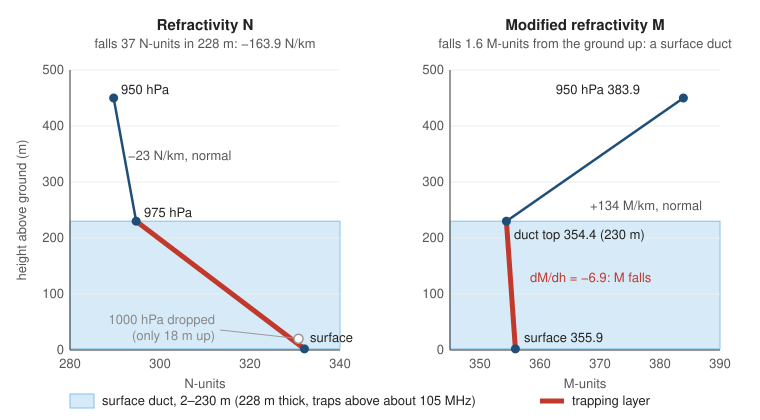

# Ducting in tropobeat

How tropobeat turns weather into a ducting score, what each class means, and how to read the `ducting` results in Kibana.

For project status and open questions, see the [rolling plan](ROLLING_PLAN.md).

## Contents

1. [What ducting is](#1-what-ducting-is)
2. [How a profile is built](#2-how-a-profile-is-built)
3. [The calculation](#3-the-calculation)
4. [Classes](#4-classes)
5. [Duct types](#5-duct-types)
6. [Scoring](#6-scoring)
7. [Field reference](#7-field-reference)
8. [How to read the results](#8-how-to-read-the-results)
9. [Kibana Maps setup](#9-kibana-maps-setup)
10. [Limitations](#10-limitations)

---

## 1. What ducting is

Radio waves bend slightly as they pass through the air, because the air's refractive index changes with height. Normally the bending is gentle and a TV signal stops near the horizon. Sometimes a layer of warm, dry air sits over cool, moist air (on a clear night, along coasts, or under a high-pressure system). The refractive index then falls so sharply with height that signals bend as much as the Earth curves. They are trapped in a **duct** and can travel hundreds of miles. When a distant station on the same RF channel reaches an LRF this way, it interferes with the local station: co-channel interference.

On every weather poll, tropobeat works out how strongly the air bends radio signals at each LRF, path midpoint and transmitter, and how likely a duct is.

## 2. How a profile is built

Each weather location has one profile per poll. It is built from:

- **The surface point**: 2 m temperature and humidity, and the surface pressure.
- **Pressure levels**: 1000, 975, 950, 925, 900, 850, 800 and 700 hPa, each with temperature, humidity and height.

Some levels are dropped (and counted in `dropped_levels`):

| Dropped because | Why |
|---|---|
| Below the terrain | The weather model extrapolates pressure levels underground at higher sites. At Denver (1,597 m), six of the eight levels are underground. |
| Less than 20 m above the point below | A tiny height difference turns rounding noise into huge, false gradients. Set by `ducting.min_layer_m`. |
| Missing values | Nothing to calculate with. |

A location needs at least **two** usable points to calculate anything. With fewer, its class is `insufficient_data`.

## 3. The calculation

Three steps at each point, then gradients between points.

| Step | Formula | Units | What it means |
|---|---|---|---|
| 1. Water vapour pressure | e = RH/100 × 6.11 × 10^(7.5·t / (t + 237.3)), with t = T − 273.15 | hPa | How much moisture the air holds. Moisture affects radio bending much more than temperature does. |
| 2. Refractivity | N = 77.6/T × (P + 4810·e/T) | N-units | The air's refractive index, scaled: N = (n − 1) × 10⁶. About 300–330 near the ground. |
| 3. Modified refractivity | M = N + 0.157·h | M-units | N adjusted for the Earth's curvature (h is height in metres). Where M **decreases** with height, signals bend at least as much as the Earth curves. |

T is temperature in Kelvin, RH relative humidity in %, P total pressure in hPa.

These are the formulas ITU-R P.453 gives for radio work. Against the recommendation's full forms they agree to within 1.2 N-units (−40 to 35 °C, any humidity, 700–1050 hPa). That's much smaller than the changes that matter, which are 16 N-units or more per 100 m.

**Worked example** (15 °C, 60 % humidity, 1013.25 hPa): e = 10.23 hPa, N = 318.9.

**Gradients.** Between each pair of points, tropobeat calculates:

- **dN/dh**: how fast N changes with height, in N-units per km.
- **dM/dh**: the same for M, in M-units per km. dM/dh = dN/dh + 157.

## 4. Classes

Each layer is classed by its dN/dh (ITU-R P.453). A location takes the class of its **steepest** layer (the most negative dN/dh).

| Class | dN/dh (N/km) | dM/dh (M/km) | What the signal does | For co-channel interference |
|---|---|---|---|---|
| `sub_refractive` | above 0 | above 157 | Bends less than normal; the horizon shrinks | Less than usual |
| `normal` | 0 to −79 | 157 to 78 | Normal bending (standard atmosphere is about −40) | Normal background |
| `super_refractive` | −79 to −157 | 78 to 0 | Bends more than normal; reaches beyond the usual horizon | Raised: distant stations can come in stronger |
| `ducting` | below −157 | below 0 | Bends at least as much as the Earth curves; can be trapped | High, if the duct traps the channel (see `trapped`) |
| `insufficient_data` | none | none | Fewer than two usable heights | Unknown: high mountain site or missing data |

## 5. Duct types

A duct is a run of one or more `ducting` layers (the **trapping layer**). Its type depends on where it sits.

| Type | Where | M profile (height up, M across) |
|---|---|---|
| `surface` | The trapping layer starts at the surface point. | M falls from the ground up to the duct top, then rises again. |
| `surface_based` | The trapping layer is higher up, but M at its top is lower than anywhere below, so the duct reaches the ground. | M rises, falls through the layer to below its surface value, then rises. |
| `elevated` | The duct is clear of the ground. Its base is where M, going down, falls back to the value at the duct top. | M rises, falls through the layer (staying above its surface value), then rises. |



In each, the red segment is the trapping layer (M falls with height) and the shaded band is the duct. The dashed line carries M at the duct top downwards: if the profile never comes back to it before the ground, the duct reaches the ground (`surface_based`); if it does, that height is the duct base (`elevated`).

Each duct reports its base and top (metres above ground), its thickness, and its strength `delta_m`: M at the base of the trapping layer minus M at its top.

## 6. Scoring

### Location score (0 to 1)

From the steepest gradient g (dN/dh, N/km), rising in a straight line within each band:

| g (N/km) | Class | Score |
|---|---|---|
| −79 or above | normal / sub-refractive | 0 |
| −79 to −157 | super-refractive | 0 rising to 0.6 |
| −157 to −300 | ducting | 0.6 rising to 1.0 |
| below −300 | strong ducting | 1.0 |



Super-refractive air is capped at 0.6, so a true duct always scores higher. The band edges and the 0.6 split are settings (`ducting.score.*`) with initial values that haven't been calibrated yet.

### Path ducting index (0 to 1)

The plain mean of the scores at the path's LRF, midpoint and transmitter:

```
index = (score_lrf + score_midpoint + score_transmitter) / 3
```

A point with `insufficient_data` is left out of the mean.

### Trapped

A duct traps a signal only if it is thick enough for the wavelength. The lowest frequency a duct traps is:

```
f_min (MHz) = 360,000 / thickness^1.5      (thickness in metres)
```

(From the US Naval Postgraduate School's EM propagation course, module 3.2.) `trapped` is true if any duct at any of the path's three points is thick enough for the path's RF channel.

| RF channel | Band | Centre (MHz) | Thinnest duct that traps it |
|---|---|---|---|
| 2 | Low VHF | 57 | 342 m |
| 6 | Low VHF | 85 | 262 m |
| 7 | High VHF | 177 | 161 m |
| 13 | High VHF | 213 | 142 m |
| 14 | UHF | 473 | 83 m |
| 36 | UHF | 605 | 71 m |

### Worked example (TERH, RF 10)

At TERH a cool, humid surface (11 °C, 96 %) sits under warm, dry air at 975 hPa (16 °C, 41 %).

| | Surface (2 m) | 975 hPa (230 m) |
|---|---|---|
| e (hPa) | 12.65 | 7.34 |
| N | 332.1 | 294.7 |
| M | 355.9 | 354.4 |



- dN/dh = (294.7 − 332.1) / 0.228 km = **−163.9 N/km** → `ducting`; dM/dh = −6.9.
- Score = 0.6 + 0.4 × (163.9 − 157) / 143 = **0.62**.
- One `surface` duct, 2 m to 230 m: thickness 228 m, `delta_m` 1.6. It traps frequencies above 105 MHz.
- With a midpoint score of 0.26 (super-refractive, −112.4 N/km) and a transmitter score of 0 (normal): **index = (0.62 + 0.26 + 0) / 3 = 0.29**.
- RF 10 is 195 MHz, above 105 MHz, so **`trapped: true`**. On RF 2 (57 MHz) the same duct would give `trapped: false`.
- Ducting state: **`trapping`** on RF 10, `ducting` on RF 2.

### Ducting state

A four-step summary for dashboards, maps and alerts, published as `tropobeat.ducting_state` with `tropobeat.ducting_level` (0–3), so a panel can take the highest level over an hour or across an LRF's paths. Unlike the index, one strong point is enough to raise it.

| Level | State | Rule |
|---|---|---|
| 0 | `normal` | No point is super-refractive or ducting (`sub_refractive` counts as normal). |
| 1 | `super_refractive` | The strongest point is super-refractive. |
| 2 | `ducting` | A point has a ducting layer, but no duct is thick enough to trap the channel. |
| 3 | `trapping` | A duct is thick enough to trap the channel (see [Trapped](#trapped)). |

- **Weather event (a path):** taken over the path's three points and its channel. `trapping` is the same as `trapped: true`.
- **Weather event (an LRF with no paths):** the LRF point's class. There is no channel, so never `trapping`.
- **Ducting event (a location):** that location's class. `trapping` if a duct there traps the channel of any path using the location.
- Points with `insufficient_data` are left out. If none is usable, the state is not set.

## 7. Field reference

### Shared fields: on every metricset

These sit directly under `tropobeat` on `cochannel`, `weather`, `ducting` and `baseline` events, so one dashboard filter (an LRF, a channel, a band, a station) works across all of them. Lists are always arrays, sorted and without duplicates; empty ones are left out.

| Field | Unit | Meaning | How to read it |
|---|---|---|---|
| `tropobeat.lrf_codes` | list | LRFs the event is about | A path's LRF; every LRF that used a ducting location; a baseline's LRF. |
| `tropobeat.path_ids` | list | Co-channel paths, `<lrf>:<facility id>:<rf channel>` | Filter on one path ID to get the path, its weather and its three ducting events. On a baseline: the paths that could interfere with that input. Not set for an LRF with no paths. |
| `tropobeat.rf_channels` | list | RF channels | On a ducting event, the channels of every path using the location. |
| `tropobeat.bands` | list | `low_vhf` (2–6), `high_vhf` (7–13), `uhf` (14–69) | Whether a duct traps a channel depends on the band. |
| `tropobeat.transmitter_call_signs` | list | Co-channel transmitters: the possible interferers | Not the LRF's own stations. |
| `tropobeat.transmitter_facility_ids` | list | FCC facility IDs of those transmitters | Stays the same when a call sign changes. |
| `tropobeat.station_call_signs` | list | The LRF's own stations on the channel(s) | From the demod input tags. |
| `tropobeat.discovery_run_id` | text | Discovery run the paths came from | Filter on the latest to see the current paths. A baseline's own run is `tropobeat.baseline.run_id`. |
| `tropobeat.forecast_time` | time | The hour the weather applies to | Weather and ducting events. Use for "what was the atmosphere doing at 03:00". `@timestamp` is when it was fetched. |
| `tropobeat.ducting_state` | text | `normal`, `super_refractive`, `ducting` or `trapping` | See [Ducting state](#ducting-state). Weather and ducting events. |
| `tropobeat.ducting_level` | 0–3 | `ducting_state` as a number | Take the maximum for heat maps and map colours. |

### Summary on `weather` events

| Field | Unit | Meaning | How to read it |
|---|---|---|---|
| `tropobeat.weather.ducting.index` | 0–1 | Path ducting index | The main number for a path. Above about 0.6 means ducting at one or more points. |
| `tropobeat.weather.ducting.frequency_mhz` | MHz | Centre frequency of the path's channel | For reference. |
| `tropobeat.weather.ducting.trapped` | true/false | A duct on the path traps this channel | Combine with `index`: both high is the strongest sign. |
| `tropobeat.weather.<point>.ducting.score` | 0–1 | Score at the LRF, midpoint or transmitter | Shows where along the path the ducting is. |
| `tropobeat.weather.<point>.ducting.class` | text | Class at that point | See [Classes](#4-classes). |
| `tropobeat.weather.<point>.ducting.min_dndh_n_per_km` | N/km | Steepest gradient at that point | Below −157 is ducting. |
| `tropobeat.weather.<point>.ducting.profile_id` | text | Links to that point's `ducting` event | Search `tropobeat.ducting.profile_id` with this value and the same poll time. |

`<point>` is `lrf`, `midpoint` or `transmitter`. Path-level fields are not set for an LRF with no paths. Point summaries are not set when the location is `insufficient_data`.

### `ducting` event: top level

| Field | Unit | Meaning | How to read it |
|---|---|---|---|
| `@timestamp` | time | When the weather was fetched | Same as the poll's `weather` events. |
| `tropobeat.ducting.profile_id` | text | The location, as "lat,lon" | Matches `profile_id` on weather points. |
| `tropobeat.ducting.location` | geo point | Where the weather applies | Use for map layers. |
| `tropobeat.ducting.elevation_m` | m | Terrain height | High sites drop more levels. |
| `tropobeat.ducting.class` | text | Class of the steepest layer | See [Classes](#4-classes). |
| `tropobeat.ducting.score` | 0–1 | Ducting likelihood | Not set for `insufficient_data`. |
| `tropobeat.ducting.min_dndh_n_per_km` | N/km | Steepest gradient | Below −157 is ducting; below −300 is strong. |
| `tropobeat.ducting.dropped_levels` | count | Levels left out | Usually 0–1 at low sites; 6 at Denver. A high count leaves few layers to judge from. |

The paths, LRFs, channels and stations that used the location, its forecast hour and its ducting state are in the [shared fields](#shared-fields-on-every-metricset).

### `points[]`: one per usable height, lowest first

| Field | Unit | Meaning | How to read it |
|---|---|---|---|
| `pressure_hpa` | hPa | Pressure | The surface point has the surface pressure. |
| `height_m` | m | Height above sea level | |
| `height_agl_m` | m | Height above ground | 2 for the surface point. |
| `temperature_k` | K | Temperature | Subtract 273.15 for °C. A rise with height is an inversion. |
| `relative_humidity_pct` | % | Relative humidity | A sharp drop with height favours ducting. |
| `vapour_pressure_hpa` | hPa | Water vapour pressure e | Falls sharply across a duct. |
| `refractivity_n` | N-units | Refractivity N | About 300–330 near the ground; falls with height. |
| `modified_refractivity_m` | M-units | Modified refractivity M | Normally rises with height; falling M is a duct. |

### `layers[]`: one per pair of consecutive points, lowest first

| Field | Unit | Meaning | How to read it |
|---|---|---|---|
| `base_agl_m`, `top_agl_m` | m | Bottom and top of the layer, above ground | Layers are often 200 m or more thick (see [Limitations](#10-limitations)). |
| `dndh_n_per_km` | N/km | Refractivity gradient | See the class table. |
| `dmdh_m_per_km` | M/km | Modified refractivity gradient | Negative means ducting. |
| `class` | text | Layer class | |

### `ducts[]`: one per duct, lowest first; empty when none

| Field | Unit | Meaning | How to read it |
|---|---|---|---|
| `type` | text | `surface`, `surface_based` or `elevated` | See [Duct types](#5-duct-types). Surface ducts affect LRF reception most directly. |
| `base_agl_m`, `top_agl_m` | m | Duct bottom and top, above ground | |
| `thickness_m` | m | Duct thickness | Decides which channels are trapped (see the table in [Scoring](#6-scoring)). |
| `delta_m` | M-units | Duct strength | Larger is stronger. With today's 200 m+ layers it is often only a few M-units, because the layer average hides the sharpest part of the duct. |

The `points`, `layers` and `ducts` lists are stored as plain objects so Kibana can use them. Elasticsearch doesn't keep each list item's fields together, so a search like "a layer with class ducting **and** top below 300 m" can match two different layers. For searching and alerting, use the top-level fields; open the lists to inspect one location.

## 8. How to read the results

| You see | It means |
|---|---|
| `ducting_state: trapping` | A duct on the path traps this channel. With a high `index`, ducting along the path is thick enough for this channel and co-channel interference is likely. |
| `class: ducting` but `trapped: false` | A duct, but too thin for this channel. Common on low-VHF channels (RF 2–6). |
| `super_refractive`, score 0.3–0.6 | Stronger bending than normal. Can bring a distant station up without full ducting, and may hide a thin duct (see [Limitations](#10-limitations)). |
| High score at the LRF only | Local conditions at the receive site; the path may not be ducting end to end. |
| High score at the midpoint | The middle of the path is ducting, which matters most for a signal crossing the whole path. |
| `insufficient_data` | Too few usable heights: usually a high site where most levels are underground, or missing weather data. |
| No ducting event for a location | With `ducting.publish: all` (the default), the weather fetch failed for that location in that poll. With `publish: notable`, the location wasn't super-refractive or ducting; its weather event still has its score and class. |

## 9. Kibana Maps setup

**Ducting layer** (one dot per location, latest result):

1. Add a **Documents** layer on the tropobeat index with geospatial field `tropobeat.ducting.location`. Filter it with `metricset.name : "ducting"`.
2. Under **Scaling**, choose **Show top hits per entity**: entity `tropobeat.ducting.profile_id`, sorted by `@timestamp` descending, 1 hit. Each location then shows only its latest result, not one dot per hour.
3. Colour the dots by `tropobeat.ducting_level` (or by `tropobeat.ducting.score`).
4. Set the **tooltip** to the summary fields: `ducting_state`, `class`, `score`, `min_dndh_n_per_km`, `ducts.thickness_m`, `ducts.delta_m`, `path_ids`. Leave out `points` and `layers`; their lists don't read well in a tooltip.

**Path layer:** add a Documents layer on `tropobeat.weather.path` (filter `metricset.name : "weather"`), with top hits per entity `tropobeat.path_ids`. Colour the lines by `tropobeat.ducting_level`, or by `tropobeat.weather.ducting.index`.

**One LRF everywhere:** a dashboard control on `tropobeat.lrf_codes` (or `rf_channels`, `bands`, `transmitter_call_signs`) filters every layer and panel at once, because every metricset has the same field.

**From a path to its ducting detail:** take the path ID from a path's tooltip and filter with `tropobeat.path_ids : "TERH:1001:10"`. The ducting layer then shows that path's three points (two if `coordinate_precision` merged the midpoint with an end point), and Discover lists their full results.

**One-click navigation:** on a dashboard, a map panel can have a drilldown that opens Discover filtered on the clicked path. Check this on your Kibana version before relying on it.

## 10. Limitations

- **Vertical resolution.** The weather model's pressure levels are about 200 m apart near the ground and up to 1,000 m higher up, while real ducts are often 20–200 m thick. A gradient across a layer is an average. For example, a 50 m duct at −400 N/km inside a 200 m layer that is otherwise normal (−40) reads as −130 N/km: `super_refractive`, not `ducting`. Read scores as a likelihood. ([Rolling plan](ROLLING_PLAN.md#4-open-questions) Q17.)
- **Trapping is generous for now.** Every detected duct spans at least one model layer, so most ducts count as trapping VHF-high and UHF channels. `trapped` will become more selective with finer vertical detail. (Q17.)
- **Initial thresholds.** The score bands come from the ITU-R P.453 classes and haven't been calibrated against real ducting events yet. (Q16.)
- **The path index is a simple mean.** It ignores the channel frequency and where along the path the duct is. (Q18.)
- **Humidity.** The vapour-pressure formula assumes humidity relative to water at all temperatures; this is being confirmed for the weather models used. Cold air holds little moisture, so the effect is small. (Q10.)
- **Data volume.** With `publish: all`, the full network produces about 62,000 ducting events a day at hourly polling. (Q19.)
